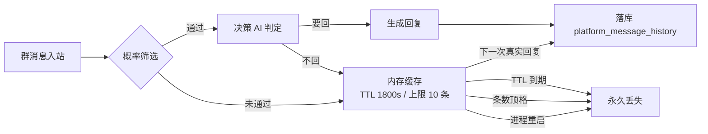


起因是一句话："分析从昨天到现在的聊天记录，分析 bot 今天的回复速度显著变慢的原因。"

结果查下来，**体感和数据并不一致**：今天真正慢的幅度只有 7%–13%，而我在过程中先后做错了三次判断——以为中转挂了、以为上下文膨胀是主因、以为决策 AI 塞了 100 条历史。三次都被数据推翻之后，才找到两个真正的问题：**被概率筛掉的消息会永久丢失**，以及**一次 4 秒的 LLM 摘要卡在用户可见的关键路径上**。

本文按 **原因 → 目的 → 修改方式评估 → 修改后效果** 复盘一遍，也把被否掉的方案一起记下来，方便以后不再踩。


# 一、起因与环境

## 1.1 问题描述

用户观察到"bot 今天回复明显变慢"，要求分析从昨天到现在的聊天记录。随后追加了两个问题：被概率筛掉的消息会不会丢、能不能把串行的 LLM 调用改成并行。

## 1.2 环境

本次排查涉及的技术栈如下，后文的结论都建立在具体版本上：

| 项目 | 版本 / 说明 |
| --- | --- |
| 聊天机器人框架 | **AstrBot 4.29.3** |
| 群聊增强插件 | `astrbot_plugin_group_chat_plus` V1.2.3.hotfix.2 |
| 角色状态插件 | `astrbot_plugin_LivelyState` v1.2.1 |
| 长期记忆插件 | `astrbot_plugin_livingmemory` |
| 运行时 | Python 3 / asyncio（单事件循环） |
| 模型上游 | OpenAI 兼容协议的网关，DeepSeek 系模型（流式） |
| 存储 | SQLite（`data_v4.db`，WAL 模式） |
| 部署 | Docker + 单容器 `astrbot` |
| 本文博客框架 | **Hexo 8.1.2 + hexo-theme-fluid 1.9.9** |

## 1.3 可用数据

排查没有靠猜，全部落在两张表与一份容器日志上：

| 数据源 | 关键字段 | 用途 |
| --- | --- | --- |
| `provider_stats` 表 | `start_time` / `end_time` / `time_to_first_token` / token 三项 | 精确算 LLM 耗时与首 token |
| `platform_message_history` 表 | `created_at` / `user_id` / `content` | 算端到端延迟、查历史是否落库 |
| `docker logs astrbot` | 10 万行，覆盖 39 小时 | 分段耗时、阶段标记、异常 |


两个容易踩的时间坑：`created_at` 存的是 **UTC**，要 +8 才是本地时间；而 `provider_stats.start_time` 是**秒级浮点 epoch**（不是毫秒）。混用时差一小时或差一千倍，结论会完全走偏。


# 二、原因：三次定位，两次推翻自己

## 2.1 第一次误判：以为今天慢了

初始假设很自然：是不是模型中转链路挂了，导致每次请求先超时再降级到官方 API。

实测直接否掉了：

| 检查项 | 结果 |
| --- | --- |
| 中转容器是否存在 | 不存在——但**不是丢失，是迁移**成了宿主机 systemd 服务 |
| `api_base` 指向 | 已改为新网关，容器内实测 `HTTP 200 / 29ms` |
| 今日 `Switched from`（降级到官方）次数 | **0** |
| 今日 503 次数 | **0** |

真正的时间对比（同 provider、同口径）：

| 指标 | 昨天 | 今天 | 变化 |
| --- | --- | --- | --- |
| LLM 耗时中位 / p90 | 2.64 / 3.32 s | 2.90 / 3.77 s | +10% / +14% |
| 端到端中位（落库到落库） | 5.71 s | 5.60 s | **持平** |
| 同窗口 10:00–15:15 端到端 | 5.07 s | 5.63 s | +11% |

**结论：今天只慢了约一成，不是"显著变慢"。** 体感与数据的差距需要另找解释。

## 2.2 第二次误判：以为上下文膨胀是主因

确实有一个客观变化：今天的输入 token 膨胀了。

| 指标 | 昨天 | 今天 |
| --- | --- | --- |
| 输入 token p90 | 28,613 | **75,194**（+163%） |
| 单次峰值 | 39,239 | **84,307** |
| 输入 >40k 的调用次数 | **0** | **32** |

看起来很严重，但拆开 token 构成后结论反转：

| 构成 | 量级 | 单价 |
| --- | --- | --- |
| cache 命中部分 | 约 **79k** | 近乎免费 |
| 未命中部分（uncached） | 约 **5.5k** | 约 24 ms / 1k |
| 输出 token | 每次几十到几百 | 约 **1.8 ms / token** |

最直接的反证：**84k 输入的 TTFT 反而比 47k 输入更低**（2.2–3.6 s vs 3.3–4.1 s）。


"上下文变长所以变慢"这个直觉在 KV cache 面前是不成立的。真正按 token 计费的是 **uncached 部分和输出**，而一次回复里输出多写 40 个字，就吃掉了几千 token 上下文省下的全部时间。


## 2.3 第三次误判：以为决策 AI 塞了 100 条历史

决策 AI 负责判断"这条消息要不要回"，它的 prompt 实测 **16,738 token**，比主生成还大。我据此推断"这里面有 100 条历史，砍到 25 条能省 0.3 秒"，并写进了待办。

三条硬证据把这个前提推翻了：

**证据一：决策 AI 传的是空上下文**

```
utils/decision_ai.py:1197    response = await provider.text_chat(
utils/decision_ai.py:1199        contexts=[],          ← 空数组
utils/decision_ai.py:1308    response = await provider.text_chat(
utils/decision_ai.py:1310        contexts=[],          ← 同上
```

**证据二：构造上下文时就跳过了历史**

```
main.py: skip_history=True
```

**证据三：模型自己的 reasoning 在抱怨**

真实日志原文：

> "**历史消息未提供**（只显示这是新消息，之前历史已处理）"
> "**实际上只有当前消息，没有历史消息内容**"

随后 token 数据直接证伪：

| 时间 | prompt_tokens | cache_hit | cache_miss |
| --- | --- | --- | --- |
| 18:14 | 17,033 | 16,128 | 905 |
| 18:20 | 17,028 | 16,256 | 772 |
| 18:25 | 16,643 | 16,256 | **387** |
| 18:31 | 16,641 | 16,256 | 385 |

**97.6% 是稳定的静态前缀**。如果里面真有 100 条历史，每轮都会有大幅波动。

真实构成是：默认判定指令 8,710 字符 + 自定义补充 6,563 字符 + 人格设定 13,431 字符 ≈ 28,704 字符 ≈ 16.2k token。


这条改动最终**零改动取消**。教训是：看到"prompt 很大"就去猜里面装了什么，不如先看一眼 `cache_hit / cache_miss` 的比值——静态前缀和动态内容的比例一目了然。


# 三、真正的原因与修改目的

三次误判清掉后，剩下两个经得起复核的问题。

## 3.1 问题一：被概率筛掉的消息会永久丢失

插件有一个"概率筛选"机制：不是每条群消息都值得回复，按概率决定处理与否。未通过的消息会被缓存，等下一次真正回复时一起"转正"落库。

问题在于，这条链路上有三处会静默丢数据：

| 通道 | 机制 | 量级 |
| --- | --- | --- |
| TTL 过期 | 内存缓存 1800 秒，超时直接丢弃 | 24h 内 362 条进入缓存 |
| 条数挤掉 | 上限 10 条，顶格后删最旧 | 日志反复出现"共10条" |
| 进程重启 | 缓存纯内存、不落盘 | 当天重启 14 次 |

事故实证：17:09:35 一条消息进入缓存，17:39:35 到期，之后再无真实回复把它转正——**数据库、JSON、内存缓存三处皆无，永久消失**。

数据流转与丢弃点如下：



## 3.2 问题二：关键路径上有一次 4 秒的同步等待

`LivelyState` 插件里有个"观察者"（GlobalObserver），负责给 bot 提供跨会话的**短期氛围摘要**——不是事实记忆，是"最近群里在聊什么、氛围如何"。机制是每攒满 20 条消息，调一次 LLM 把 20 条压成一段摘要，下一轮注进 prompt。

它被放在 `on_llm_request` 钩子里，**同步 await**：

| 指标 | 数值 |
| --- | --- |
| 单次摘要耗时 | 中位 **4.41 s**，p90 **7.09 s** |
| 命中频率 | 约每 10 轮请求一次 |

一轮命中的真实时间线：

```
31.854  决策AI 判断 yes
32.186  开始摘要 ──── 4.92s ────► 37.114
37.377  主生成开始
40.162  生成结束
41.183  Prepare to send
```

**该轮用户可见延迟 9.3 秒，其中 4.92 秒（53%）花在等这段摘要。** 期间 bot 没有任何用户可见输出。

讽刺的是，同一个插件里 `judge_dialogue_event` 早就用 `asyncio.create_task` 异步化了，代码注释写得明明白白：

> "为什么不放 on_llm_request：那会串行阻塞 1.5 秒。…放 on_llm_response 并用 create_task，回复立即发出…代价是状态延迟一轮生效，对状态系统可接受。"

**同样的取舍对观察者完全成立，但作者没在观察者上做。**

## 3.3 本次目的

| 目的 | 目标 |
| --- | --- |
| 止血 | 被概率筛掉的消息不再因 TTL 而过期丢失 |
| 提速 | 把摘要 LLM 移出用户可见路径，降低 p90 延迟 |
| 不误伤 | 不动人格设定、不动主生成上下文窗口、不做未经证实的优化 |

# 四、修改方式与方案评估

## 4.1 消息丢失：六个方案的对比

问题不难，难在选哪个改法。候选方案与评估：

| 方案 | 改动量 | 影响面 | 风险 | 是否解决永久丢失 |
| --- | --- | --- | --- | --- |
| ① 概率筛掉时立即落库 | ~15 行 | 仅覆盖 1/4 缓存入口 | **高**：落库无去重，后续转正会重复插入 | 部分 |
| ② 延长 TTL 到 7200s | 0 行（配置） | 内存几乎不增 | 低 | **否**：把"过期丢"换成"顶格挤掉"，更隐蔽 |
| ③ 新增定时任务转正 | ~30 行 | 覆盖全部入口 | 中：与原计时器抢同一会话 | 是 |
| ④ 落库打"未回复"标记 | ~10 行 | 会污染 prompt 文本或 sender 昵称 | **高**：已写入的标记无法清理 | 是（代价不可接受） |
| ⑤ 缓存落盘 + 启动恢复 | ~60 行 | 只解决"重启丢" | 中 | **否**：不对症 |
| **⑥ TTL 兜底转正（选中）** | **~15 行 + 1 行配置** | 覆盖全部入口 | **低**：复用现成通道 | **是** |

选中方案⑥的关键，是先发现了一个事实：**这条落库通道早就写好了，只是开关从没打开过。**

插件自带 `_idle_flush_worker` → `_do_idle_flush` → `flush_cached_messages_by_params`，一条完整的不依赖回复的落库链路，写 `conversations` → `platform_message_history` → JSON 三处。但 `enable_idle_cache_flush` 配的是 `false`，24 小时日志里触发次数为 **0**。

更微妙的是：**只打开开关还不够**。那段计时是固定 600 秒静默，而每条新消息都会 `cancel` 重建它——活跃群里消息间隔小于 600 秒，计时器永远等不到到期。

所以最终是两处改动：

**改动 A**（配置，1 行）：`enable_idle_cache_flush: false → true`

**改动 B**（源码，约 15 行）：把计时收窄到「最老缓存消息到期前 60 秒」

```python
# ponytail: 冷群计时会被"群一直有人说话但 AI 不回复"无限推后，缓存熬到 TTL 后被丢。
# 这里把计时收窄到「最老缓存消息到期前 60 秒」以内，兜住活跃群。
_gcp_delay = self.idle_cache_flush_delay_seconds
_gcp_ttl = min(max(60, int(self.pending_cache_ttl_seconds or 0)), 7200)
_gcp_oldest = 0.0
for _gcp_msg in self.cache_manager.pending_messages_cache.get(chat_id, []):
    _gcp_ts = _gcp_msg.get("message_timestamp") or _gcp_msg.get("timestamp") or 0
    if _gcp_ts and (_gcp_oldest <= 0 or float(_gcp_ts) < _gcp_oldest):
        _gcp_oldest = float(_gcp_ts)
if _gcp_oldest:
    _gcp_remain = _gcp_oldest + _gcp_ttl - time.time() - 60
    _gcp_delay = max(15, min(_gcp_delay, int(_gcp_remain)))

self._idle_flush_tasks[chat_id] = asyncio.create_task(
    self._idle_flush_worker(chat_id, _gcp_delay)
)
```

**为什么这个方案风险最低**：写入仍走 `_do_idle_flush` 原有函数，与正常回复转正**同一条路径、同一套字段顺序**。方案①会引入"即时落库"和"转正落库"两套时序，还要额外负责去重；方案⑥没有第二套语义。

## 4.2 观察者异步化：三个必须堵的坑

把 `if await self._trigger_summarization(...)` 改成 `asyncio.create_task` 看起来是一行的事，实际上有三个坑，任何一个漏掉都会引入新 bug：

| 坑 | 后果 | 处理 |
| --- | --- | --- |
| 计数不清零 | 原逻辑 `new_message_count = 0` 在 `await` 返回后才执行；异步化后任务不再回写，会**每轮都触发** | 清零提到派发之前 |
| 任务无引用 | `create_task` 裸调，任务可能在运行中被 GC 回收 | 实例集合持强引用，`add_done_callback` 里 `discard` |
| 并发重入 | 两次摘要竞态覆盖共享状态，且重复消耗额度 | `_summary_inflight` 布尔闸门，in-flight 期间不派发 |

最终改动：

```python
if self.new_message_count >= self.trigger_threshold:
    # ponytail: 摘要是不进用户可见路径的旁路工作，不能卡在 on_llm_request 里等
    # （实测中位 4.41s / p90 7.09s，命中时占该轮延迟一半以上）。改为后台任务。
    self.new_message_count = 0  # 先重置计数：后台任务不再回写，否则每轮都触发
    if not self._summary_inflight:
        self._summary_inflight = True
        _task = asyncio.create_task(self._run_summary_async(event, context))
        self._summary_tasks.add(_task)
        _task.add_done_callback(self._on_summary_done)
```

`_trigger_summarization` 的函数体**一字未改**——只改调用方式，不改业务逻辑。

**需要接受的代价**：摘要结果**晚一轮请求才可见**。这跟作者在 `judge_dialogue_event` 上已经接受的代价是同一个。

## 4.3 为什么不动决策 AI

前面 2.3 已经证明"砍历史"无从下手。那还能不能优化决策 AI 的 1.93 秒？

日志里有个此前没人注意的细节：

```
completion_thinking_tokens = 97 / 224 / 145 / 212 / 172
reasoning_content = "……返回 no。"
```

**67% 判"不回复"的调用，每次都先吐 100–220 个 reasoning token 才说出 `no`。**

理论上可以换掉 reasoning 开关，但：

- 决策质量直接决定"该回不回 / 不该回乱回"，属行为变更
- 16.2k 里 97.6% 走 cache，砍静态 prompt 对墙钟时间几乎无影响
- 需要 A/B 才能确认判定准确率不掉

**结论：本次不动。** 宁可少省 0.3–0.8 秒，也不拿回复质量冒险。

## 4.4 改动清单

| 项 | 文件 | 改动 |
| --- | --- | --- |
| A | `astrbot_plugin_group_chat_plus_config.json` | `enable_idle_cache_flush` 开为 `true` |
| B | `astrbot_plugin_group_chat_plus/main.py` | 冷群计时按最老缓存消息收窄 |
| C | `astrbot_plugin_LivelyState/main.py` | 观察者摘要改后台任务（净 +23 行） |
| — | 决策 AI | **零改动**（前提不成立，主动取消） |

三处改动均先备份、再改、`py_compile` 校验、重启验证，并写进本地修改记录与补丁清单。

# 五、修改后效果

## 5.1 量化对比

| 指标 | 改前 | 改后 |
| --- | --- | --- |
| 观察者命中轮的摘要阻塞 | 4.26 / 4.93 / 5.18 / 5.86 / 6.58 / 7.63 s（6 个样本） | **0.001 s** |
| 打桩验证（3 秒 sleep 模拟摘要） | 同步时 ≈ 3 s | **0.0000 s** |
| 被概率筛掉消息的归宿 | TTL 到点永久丢失 | 到期前 60 秒自动转正落库 |
| 覆盖的缓存入口 | 1/4（仅真实回复） | **全部**（概率过滤 / AI 判断 / 窗口缓冲 / 批量回落） |

补丁自检：消息丢失方案 17 项断言、观察者异步化 21 项断言，全部通过。

## 5.2 尚未验证的部分

诚实记录两点：

1. **冷群兜底转正还没有真实触发过。** 它需要群里出现一条"不会被回复"的消息，观察窗口最长 `min(600, 1800−60)` 秒。
2. **那个成功日志被 `if self.debug_mode:` 挡着**，而当前 debug 未开启——**即使生效也不会打印**。验证只能查数据库 B 族是否新增行，看日志会误判成"没生效"。

这个细节值得单独记一笔：**验证手段本身可能失效**，比功能失效更难发现。

## 5.3 没被采纳的优化方向

排查过程中还评估过几项，结论都是"收益不匹配复杂度"：

| 方向 | 理论收益 | 不做的理由 |
| --- | --- | --- |
| 决策 AI ∥ 主生成（投机并行） | 省 1.93 s | 67% 的生成白跑；未发送的 assistant 消息会污染历史；额度近乎翻倍 |
| 多图转文字并发 | (n−1)×4.7 s | 24h 只出现 1 次真实调用，低频 |
| KB 与记忆召回 embedding 去重 | 0.16 s | 需要跨插件加缓存层，改动 ~30 行 |
| 停止截断历史条数 50 → 30 | 省 0.05 s | 收益小于测量噪声（残差 sd 0.38 s），代价是记忆窗口从 117 分钟砍到 20 分钟 |

# 六、复盘

## 6.1 三条经验

**第一，体感和数据要分开记账。** "显著变慢"是体感，7%–13% 是数据。差异本身是线索——它说明真正的痛点不在平均值，而在长尾（p90 上升、偶尔出现 12 秒的回复）。

**第二，cache 改变了成本结构。** 在 KV cache 面前，"上下文越长越慢"不成立。判断成本要看 `cache_hit / cache_miss` 比例，以及输出 token 数。

**第三，改之前先验证前提。** 三次误判里有两次是"假设未验证就写进方案"。如果按"砍决策 prompt 历史"去改，会浪费一整个改动周期，且改完发现根本没生效。

## 6.2 一处值得记住的反直觉

排查过程中有一个细节反复出现：**已有的机制往往只是没打开**。

冷群转正通道写得很完整——计时器、worker、三处落库、异常处理全都在，配置项甚至在提示里写着"建议设置为小于等于缓存消息过期时间的值，否则缓存会在转正前就过期丢失"。而它一直是 `false`。

所以遇到"数据会丢"这类问题时，**先检查有没有现成但未启用的通道**，比新写一条并行通道更省事，也更不容易引入第二套语义。

## 6.3 自查命令

两处改动的校验锚点（换环境重打补丁时用）：

```bash
# 冷群缓存 TTL 兜底
grep -c "ponytail: 冷群计时会被" <group_chat_plus>/main.py        # 1
grep -c "async def _idle_flush_worker(self, chat_id: str, delay: int = 0)" <...>/main.py  # 1

# 观察者异步化
grep -c "ponytail: 摘要是不进用户可见路径的旁路工作" <LivelyState>/main.py   # 1
grep -c "_summary_inflight" <LivelyState>/main.py                            # 5
grep -c "await self._trigger_summarization" <LivelyState>/main.py             # 1（仅存在于后台包装内）
```

# 参考资料

- [AstrBot 官方文档](https://astrbot.app/) — 插件钩子 `on_llm_request` / `on_llm_response` 的生命周期与阻塞语义
- [Python asyncio — Coroutines and Tasks](https://docs.python.org/3/library/asyncio-task.html#asyncio.create_task) — `create_task` 的任务引用与 GC 行为
- [SQLite WAL 模式](https://www.sqlite.org/wal.html) — 排查期间只读打开数据库的前提
- [Hexo 文档](https://hexo.io/docs/) — 本文所在博客的生成框架
