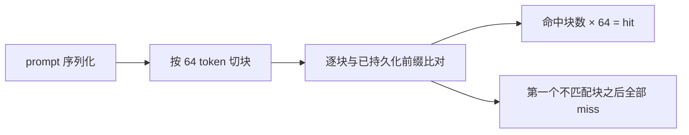
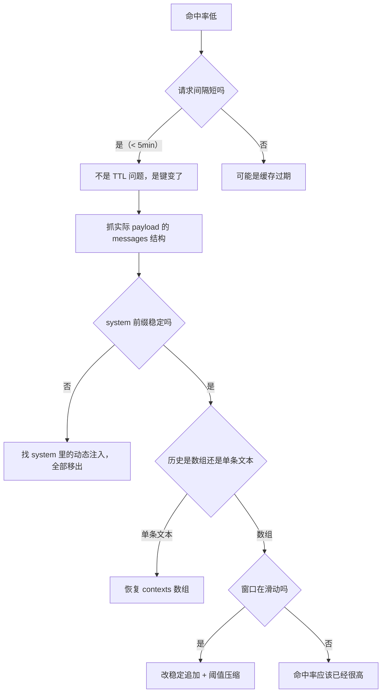


DeepSeek 控制台显示输入 token 的缓存命中率只有 40% 左右，而按官方计价，命中部分的价格是未命中的十分之一。本文记录一次从「怀疑缓存机制」到「定位到 prompt 第一个字节」的完整排查：实测真实命中率其实只有 33.4%，真正生成聊天内容的主回复更是只有 8.9%。根因不是缓存过期，而是**每轮请求都在改动缓存的第一个字节**。最终通过三处结构改动把命中率做到 80.2%，同时记录了排查过程中几个把我带偏的错误结论。


# 一、背景与初始现象

## 1.1 环境

| 项 | 值 |
| --- | --- |
| 框架 | AstrBot（Docker 部署） |
| QQ 协议端 | SnowLuma |
| 模型 | `deepseek-flash`，`modalities: ["text"]` |
| 调用方式 | OpenAI 兼容接口，非流式 |
| 插件 | group_chat_plus（群聊增强）、LivelyState（状态记忆）、livingmemory（长期记忆）、meme_manager 等 |
| 上下文窗口 | `max_context_messages = 100` |

## 1.2 现象

DeepSeek 平台统计显示输入 token 的缓存命中率约 40%。直觉上这是一个"高频短消息群聊"场景——同一批历史被反复重发，每次只追加几十字，理论上正是前缀缓存最该发挥作用的形态，实际却几乎全 miss。

## 1.3 先把真实数字测出来

AstrBot 在 DEBUG 级别会打印完整的 `ChatCompletion` 对象，其中包含 DeepSeek 返回的两个关键字段：`prompt_cache_hit_tokens` 与 `prompt_cache_miss_tokens`。直接解析 24 小时日志：

```bash
docker logs astrbot --since 24h 2>&1 \
  | grep -oE "prompt_cache_hit_tokens=[0-9]+" \
  | awk -F= '{s+=$2; n++} END {print n" 次请求，命中 "s}'
```

实测 632 次请求、504 万 prompt token，token 加权命中率 **33.4%**。按任务拆开看才是真相：

| 任务类型 | 次数 | 命中率 |
| --- | --- | --- |
| **主回复（真正生成聊天内容）** | 171 | **8.9%** |
| 决策 AI（读空气 yes/no） | 173 | 55.8% |
| 记忆提取 / 打标 / 摘要 | 272 | 33.7% |

整体 33.4% 是被大量小请求拉高的。真正要优化的是主回复那 8.9%。


这里有个容易踩的口径坑：AstrBot 的 `provider_stats` 表只记录主回复（唯一写入点是 `agent_sub_stages/internal.py`），插件内部通过 `provider.text_chat()` 发起的决策 AI、记忆反思、打标请求**完全不落库**。所以 WebUI 统计页显示 8.7%，而日志全量是 33.4%——两者不是矛盾，是分母不同。要做优化必须看日志，不能看面板。


# 二、先搞清 DeepSeek 的缓存粒度

在动任何代码之前，需要先确认一件事：缓存的单位是什么。

把所有实测到的 `hit` 值排在一起：`0 / 512 / 1920 / 2304 / 3712 / 5376 / 5760 / 6400 / 12288 / 15616`。

**没有一个是 64 的倍数之外的数。** 5376 = 84 × 64，12288 = 192 × 64。



由此得到两条必须记住的推论：

1. **`hit` 是向下取整的**，`hit = floor(可复用前缀 token 数 / 64) × 64`。看到 5376 不代表"命中了 5376 个 token"，而代表"可复用前缀落在 [5376, 5440) 区间内"。
2. **前缀必须逐字节稳定**。只要第一个 token 变了，后面全部作废——不存在"部分相似也能命中"。


官方文档的说法是「缓存命中依赖完整匹配已持久化的前缀单元」，且采用 best-effort 机制、不保证每次命中。这解释了为什么同一分钟内两次请求仍可能全 miss——但本次排查证明了，在这个场景里 miss 的原因是键变了，不是缓存凉了：请求间隔中位数只有 1 分钟，47/59 次在 5 分钟内，同一分钟内两次请求依然 `hit=0`。


# 三、框架的 prompt 是怎么拼出来的

## 3.1 system prompt 的组装顺序

AstrBot 的 system prompt 不是一整块配置，而是由框架和多个插件按钩子顺序逐段追加出来的。群聊请求的最终结构：

| 顺序 | 内容 | 来源 | 每轮变化 |
| --- | --- | --- | --- |
| 1 | `You are running in Safe Mode.` + 安全规则 | 框架 `_apply_llm_safety_mode` | 否 |
| 2 | `# Persona Instructions` + 人格正文 | 框架 / 插件 `PLUGIN_CUSTOM_SYSTEM_PROMPT` | 否 |
| 3 | `TOOL_CALL_PROMPT` | 框架 `astr_main_agent.py` | 否 |
| 4 | meme_manager 表情包语义指令 | 插件，`priority=99999` | 否 |
| 5 | **gcp 静态指令 3282 字符** | 插件 `main.py`，`priority=-1` | 否 |
| 6 | `## Skills` 段 2990 字符 | 插件，动态构建 | 否（但见 4.4） |
| 7 | **`[系统信息-情绪参考: 疑惑…]`** | 插件，`priority=0` 之前 | **是** |

## 3.2 钩子的执行顺序

AstrBot 的 `filter.on_llm_request(priority=N)` 排序规则是 **priority 越大越先执行**：

```python
# astrbot/core/star/star_handler.py
self._handlers.sort(key=lambda h: -h.extras_configs["priority"])
```

所以 `meme_manager(99999)` → `LivelyState(0)` → `gcp(-1)` 依次执行，每段都往 `req.system_prompt` 尾部追加。**后执行的插件内容排在后面。**

这个顺序带来一个结构性缺陷：`LivelyState` 在 `priority=0` 时把自己的动态状态块追加到尾部，随后 `gcp` 在 `priority=-1` 又把 3282 字符的静态指令追加到**动态块之后**——静态内容被动态内容顶到了后面，导致它每轮都跟着失效。

## 3.3 一个反直觉的发现：工具定义根本没发出去

排查初期花了不少时间怀疑「47 个工具 schema 每轮重发导致缓存失效」，最后发现这个假设不成立：

```python
# astrbot/core/agent/runners/tool_loop_agent_runner.py
def _func_tool_for_provider(self) -> ToolSet | None:
    if not self.req.func_tool:
        return None
    modalities = self.provider.provider_config.get("modalities", None)
    if isinstance(modalities, list) and modalities and "tool_use" not in modalities:
        logger.debug("Provider ... does not support tool_use, clearing tools for request.")
        return None
```

provider 配置是 `modalities: ["text"]`，不含 `tool_use`，所以 **tools 数组每次都是 `None`**。日志里 `does not support tool_use` 出现 176 次，与主回复请求数完全对齐。

顺带说明：即使补上 `tool_use`，工具顺序本身也是稳定的（`tool.py` 里 `sorted(self.tools, key=lambda t: t.name)`，注释就写着 "Stable ordering preserves prompt-cache prefixes"）。但工具**集合**会按会话类型动态增减（群聊多 `get_group_message_history`、`future_task` 等），会让群聊和私聊两条链路互不命中。

## 3.4 一次请求的真实 payload

在 `openai_source.py` 的 `_query` 里、`_sanitize_assistant_messages` 之后加了一段只记哈希和长度的探针，抓到实际发送结构：

```
msgs=2  sys_len=11280  total_chars=25907
  m[00] role=system  len=11280
  m[01] role=user    len=14627   ← 100 条历史 + 当前消息全在这里
```

**只有两条消息。** 100 条历史被拼成一整段 user 文本——这是理解后面所有问题的关键。

# 四、定位：四个破坏前缀的因素

## 4.1 LivelyState 把每轮变化的数字写进 system

`astrbot_plugin_LivelyState/main.py` 的 `add_state` 钩子：

```python
global_state_prompt = self._build_global_state_system_prompt(uid, state_info)
req.system_prompt = "\n\n".join(
    part for part in [(req.system_prompt or "").strip(), global_state_prompt.strip()] if part
)
```

而 `global_state_prompt` 里包含：

```python
"updated_at": ...,
"last_update_ts": round(last_update_time, 3),
"elapsed_sec": round(time_elapsed, 1),   # 每次请求都不同
```

**这是最致命的一处**：动态内容被追加到 system 尾部，但它后面还有 `gcp` 追加的 3282 字符静态指令，于是静态指令每轮都跟着失效。

决定性证据来自 `cached_tokens` 的取值分布：命中值精确卡在 **2304**（= persona「希可MKⅡ」3746 字符 × 0.615 token/字符，对齐到 64 的倍数）。而 persona 切换时间线与缓存值切换时间线完全吻合——旧 persona「希可」739 字符对应 `cached=512`，新 persona 上线后立刻变成 `cached=2304`。**缓存永远且只命中到 persona 结尾。**

## 4.2 `contexts=[]` 把 100 条历史压成一条文本

`group_chat_plus/utils/reply_handler.py` 里原本有这么一段：

```python
# 🔧 v1.2.2-hotfix.1: 不再构建 contexts 数组，改为全部依赖 full_prompt 文本传递历史上下文。
# 原因：群聊中所有非 bot 消息都被标为 role="user"，LLM 在结构层面无法区分
# 不同用户的发言，导致消息密集时 AI 混淆发送者身份。
contexts = []
```

这个改动的动机是合理的（群聊里多个人的消息 role 都是 `user`，模型分不清谁是谁），但代价极大：**放弃了 messages 数组天然的"逐条追加"语义**。100 条历史被格式化成 12805 字符塞进一条 user 消息，任何一条变动都让整条消息作废。

## 4.3 滑动窗口让前缀每轮左移

```python
# main.py
history_messages = history_messages[-max_context:]
```

`max_context_messages = 100`，每轮取最近 100 条。第 101 条进来时，最老那条被丢弃，**整段文本左移一条**。

实测：取 100 条真实群聊历史，`raw[-101:-1]` 与 `raw[-100:]` 的公共前缀只有 **239 / 12753 字符 = 1.9%**，分叉点精确落在第一条历史消息上。

这一条是结构性的：只要历史是"最近 N 条"，前缀就必然失效，任何"调整提示词位置"的改法都救不回来。

## 4.4 两个"白花钱"的发现

**双重前缀**：历史存储时 `message_str` 已带 `[时间] 名字(ID:x):` 元数据，`format_context_for_ai` 又加了一层。实测近 100 条里有 **68 条**是 `[ts] 名(ID:): [ts] 名(ID:): 内容`，重复元数据约 1700 字符。

**从未被使用的 Skills 段**：system prompt 里有 2990 字符的 `## Skills` 段，列了 documents / pdf / skill-creator / spreadsheets 四个技能。但：

- 技能的加载方式在 prompt 里写死为「模型自己执行 `cat <SKILL.md 绝对路径>`」
- `computer_use_runtime = "none"` → 没有 shell、没有 python
- `modalities: ["text"]` → 工具不发送

7 天内 669 次补全里，带 `tool_calls` 的 **0 次**，日志里 `SKILL.md` 命中 **0 次**。这 3000 字符是「每次群聊都付费、但永远不产生任何行为」的纯装饰，而且内容是模型无法执行的指令。

# 五、改造：三处改动必须按顺序做

## 5.1 P0：把动态状态移出 system prompt

LivelyState 不再碰 `system_prompt`，改为注入 `extra_user_content_parts`：

```python
from astrbot.core.agent.message import TextPart

if global_state_prompt.strip():
    req.extra_user_content_parts.append(
        TextPart(text=global_state_prompt.strip()).mark_as_temp()
    )
```

`mark_as_temp()` 会设置 `_no_save = True`，含义是"只对 provider 可见、不落历史"（`openai_source.py` 发送前会删掉这个字段，写历史时也会过滤）。框架会把 `extra_user_content_parts` 拼到**同一条 user 消息的 content 数组末尾**，不新开消息，也不污染 system。


另一个可选方案是把 LivelyState 的 `priority` 改成 `-2`，让它在 gcp 之后执行。这个方案确实有效（排序是降序，`-2` 排在 `-1` 后面），但会引入两个新问题：一是 `gcp` 在 handler 末尾会清理 `_gcp_per_plugin_injections`，LivelyState 之后执行会重新写回，event 被复用时可能重复拼接；二是 `req.prompt` 里 `recent_context` 的位置从尾部变成头部，模型看到的主次关系变了。改 `extra_user_content_parts` 更彻底——system prompt 变成 100% 静态。


## 5.2 阶段 1：恢复结构化历史

新增一个方法，把历史消息转成 OpenAI messages 数组：

```python
@staticmethod
def build_structured_contexts(history_messages, bot_id, include_timestamp=True) -> list:
    contexts = []
    for msg in history_messages or []:
        # 发送者信息在 msg.sender 里，不是 msg.sender_id
        sender_name, sender_id = "未知用户", "unknown"
        if hasattr(msg, "sender") and msg.sender:
            sender_name = msg.sender.nickname or "未知用户"
            sender_id = msg.sender.user_id or "unknown"
        is_bot = str(sender_id) == str(bot_id)

        content = ContextManager._strip_metadata_prefix(
            ContextManager._content_to_safe_text(msg.message_str)
        )
        # ... 拼时间戳与发送者前缀 ...
        contexts.append({
            "role": "assistant" if is_bot else "user",
            "content": text,
        })
    return contexts
```

关键设计：

- **bot 自己的回复用 `role=assistant`**，补上了原实现完全缺失的"哪句是我说的"结构信号
- **发送者身份仍保留在文本前缀里**（`昵称(ID:x):`），与 role 正交，两者不冲突——这就解决了当初 `contexts=[]` 想解决的那个问题
- **剥离双重前缀**，省掉约 1700 字符

同时 `format_context_for_ai` 加 `skip_history` 参数，历史进 contexts 后 prompt 只保留当前消息与窗口缓冲，避免同一批历史发送两遍。

## 5.3 阶段 2：稳定追加窗口

这是提升最大的一步。三处截断点全部改为"阈值压缩"：

```python
_hard_limit = max_context                   # 200
_keep_recent = max(10, max_context // 2)    # 100

if before_cnt > _hard_limit:
    _drop = before_cnt - _keep_recent
    history_messages = history_messages[_drop:]
    logger.info(f"[稳定窗口] 压缩: {before_cnt} -> {len(history_messages)}")
else:
    logger.info(f"[稳定窗口] 追加模式: {before_cnt}/{_hard_limit} 条")
```


`context_manager.py` 里有**两处**截断先于 `main.py` 执行。只改 `main.py` 的话，拿到的永远只有 100 条，阶段 2 完全失效。三处必须一起改。


配置同步从 100 调到 200：

```json
{ "max_context_messages": 200 }
```

**"条"是消息条数，不是对话轮次。** 群聊里 user 和 assistant 各占一条，且多个发送者交替，200 条约等于 100 轮。压缩目标 100 条，按群聊节奏约每 50 轮压缩一次。

# 六、效果

## 6.1 逐步演进

| 阶段 | prompt | hit | 命中率 |
| --- | --- | --- | --- |
| 初始（msgs=2，全塞一条 user） | 15226 | 5376 | **35.3%** |
| 停用未使用的 Skills | 14924 | 6400 | 42.9% |
| 阶段 1（结构化历史） | 13520 | 6400 | 47.3% |
| **阶段 2（稳定窗口）** | 15329 | **12288** | **80.2%** |

注意阶段 1 的特征：`hit` 绝对值**没变**（6400），提升来自分母变小（prompt 从 15226 降到 13520）。这说明只做结构化历史是不够的——历史虽然拆成了独立 message，但窗口仍在滑动，user 侧前缀依然无法命中。**必须配阶段 2。**

## 6.2 阶段 2 生效的直接证据

```
[稳定窗口] 追加模式: 148/200 条 (未达阈值不截断，前缀保持稳定)
[稳定窗口] 追加模式: 150/200 条
[稳定窗口] 追加模式: 153/200 条
[稳定窗口] 追加模式: 155/200 条
```

对应的请求：

| 时间 | msgs | prompt | hit | 命中率 |
| --- | --- | --- | --- | --- |
| 首轮（窗口刚切换） | 150 | 15094 | 6272 | 41.6% |
| 第二轮 | 152 | 15034 | **12160** | **80.9%** |
| 第三轮 | 155 | 15394 | 12160 | 79.0% |
| 第四轮 | 157 | 15329 | **12288** | **80.2%** |

`msgs` 单调增长（150 → 152 → 155 → 157），`hit` 从 6400 翻倍到 12288。首轮只有 41.6% 是因为窗口策略刚切换、上一轮前缀对不上——这是一次性代价。

## 6.3 为什么阶段 2 是决定性的

同一套代码、同一个 bot，命中率能差 2 倍，差别只在历史是否在滑动：

```
A: prompt=22366 hit=19712  (87%)  ← 历史稳定，前缀复用
B: prompt=13520 hit=6400   (47%)  ← 历史滑动，只命中 system
```

这组数据是阶段 2 必要性的最强证据。

# 七、排查中犯的错（值得记下来）

## 7.1 "5376 就是 system 全部命中"——错

看到 `sys_sha` 五次一致、`hit` 恒为 5376，加上 `5376 = 84 × 64`，得出"system 已 100% 命中、miss 全在 user 侧"的结论。

实际 payload 显示 `sys_len = 11280` 字符 ≈ 6768 token，**5376 覆盖不到全部 system**。错在拿"64 的倍数"当充分证据——它只能说明 hit 是向下取整的，不能说明 system 有多长。

正确的验证方式是记录**实际发送的 messages 数组**（角色 + 长度 + 哈希），而不是推测。这也是为什么后来在 `_query` 里加了探针。

## 7.2 "Skills 不破坏缓存"——错

因为 5 次请求里 Skills 段的 sha 逐字相同，判断它没破坏缓存。停用后 `hit` 从 5376 涨到 6400（+1024），**Skills 确实在破坏**。

## 7.3 上线时漏了 import

`reply_handler.py` 里调用了 `ContextManager.build_structured_contexts()`，但没导入 `ContextManager`。异常被 `try/except` 吞掉后回退为空——历史已经从 prompt 移走了，却没补进 contexts，**上下文一度丢失**。

这个 bug 的教训是：`except Exception` 里静默降级会掩盖致命错误。后来改成保留告警日志，并把 `bot_id` 为空的情况也显式告警，不再静默。

## 7.4 取错字段导致 role 全部变成 user

第一版写的是 `getattr(msg, "sender_id", "")`，实际应该取 `msg.sender.user_id`。结果 `is_bot` 恒为 False，100 条历史全部变成 `role=user`——退化回原实现想解决的问题。

修复后的结构：

```
m[01] role=user       [2026-10-27 周二 17:24:12] 江上清风(ID:<USER_ID>): ...
m[02] role=assistant  【禁止重复-你的历史回复】AstrBot(ID:<BOT_ID>): 还是这...
m[03] role=user       [2026-10-27 周二 17:30:37] 江上清风(ID:<USER_ID>): ...
m[04] role=assistant  【禁止重复-你的历史回复】AstrBot(ID:<BOT_ID>): 又是这...
```

# 八、遗留与取舍

## 8.1 压缩轮的一次性代价

历史达到 200 条会压缩到 100 条，那一轮前缀完全变化，`hit` 会掉回约 6400。按群聊节奏约每 50 轮一次，摊薄后影响约 2%。

## 8.2 剩余约 3000 token 的 miss

当前 80.2% 之外的部分来自：

| 来源 | 量级 | 是否值得优化 |
| --- | --- | --- |
| 当前消息本身 | 必然不同 | 不可优化 |
| 记忆注入 5 条（top-k 每轮不同） | 约 2500 token | 不建议——会牺牲召回质量 |
| system 尾部抖动 | 约 71 字符 | 影响 < 1%，不值得 |

记忆注入走的是 `extra_user_content_parts`（位置正确，在 user 尾部），本身不破坏前缀。它的问题只是"纯增量且每轮不同"，属于功能取舍而非 bug。

## 8.3 成本与命中率的权衡

`max_context_messages` 从 100 调到 200 后，单次 prompt 从约 13000 涨到约 15300。命中率虽高，绝对 token 数也多了。按官方计价（命中部分约为未命中的 1/10），综合成本仍然下降，但如果对成本极度敏感，可以降到 150（压缩目标 75）。

## 8.4 可复用的判断准则

排查这类问题的顺序应该是：



核心只有一句话：**缓存不是"内容相似"就能命中，而是"前缀逐字节相同"才能命中**。所有优化都归结为——把会变的东西推到末尾，把不变的东西锁在前面。

# 参考资料

- [DeepSeek API 文档 - Context Caching](https://api-docs.deepseek.com/guides/kv_cache)
- [AstrBot 官方仓库](https://github.com/AstrBotDevs/AstrBot)
