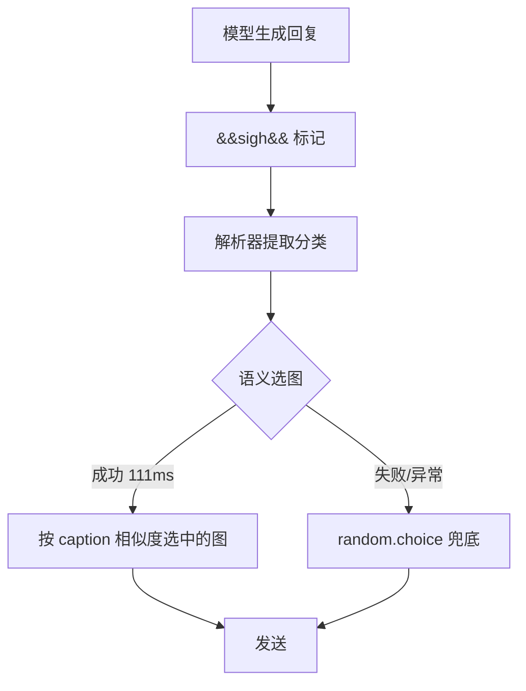


给 QQ 机器人加表情包功能之后，遇到了一个典型的工程权衡：**模型能判断"该不该发表情"，却只能指定"哪一类"，具体发哪一张全靠随机**。要让选图也懂语义，最直接的做法是让 LLM 再做一次选择——实测多花 4.2 秒。本文记录如何在不牺牲响应速度的前提下拿到语义选图，以及最终方案为什么是"保留旧模式的快速路径，只把分类内随机换成分类内按 caption 相似度选"。


# 一、环境与问题

## 1.1 运行环境

本文所有实测数据来自下面这套真实部署，不是本地模拟：

| 项目 | 配置 |
| --- | --- |
| 机器人框架 | **AstrBot**（`soulter/astrbot:latest`，Docker 部署） |
| QQ 协议端 | snowluma（`motricseven7/snowluma:latest`） |
| 对话模型 | DeepSeek `deepseek-flash`（`api.deepseek.com/v1`） |
| 向量模型 | SiliconFlow `BAAI/bge-m3`（1024 维） |
| **表情包插件** | **表情感知 meme_manager**（`astrbot_plugin_meme_manager`，v5.2.9） |
| 宿主机 | Debian 10（4.19 内核），1.7 GB 内存 |

表情感知插件是本文的主角，项目地址：

- GitHub：<https://github.com/anka-afk/astrbot_plugin_meme_manager>
- 作者：anka
- 能力：WebUI 表情包管理、资源广场、语义检索、AI 智能发送、自动收集、会话与人格选包、云端同步

插件数据目录结构（下文所有路径以此为准）：

```
data/plugin_data/meme_manager/
├── packs/ddzs987-semantic-001/          # 表情包本体
│   ├── memes/                           # 按分类分目录
│   │   ├── angry/  sigh/  happy/  ...
│   ├── semantic_metadata.json           # 398 张图的 caption + tags
│   └── memes_data.json                  # 分类键 → 用途描述
├── semantic_indexes/ddzs987-semantic-001/
│   ├── index-1fede6a2ed984a229a6eadb8b9f5bc82.faiss   # FAISS 向量索引
│   ├── index_manifest.json              # entry_id ↔ faiss_id 映射
│   └── provider_selection.json          # embedding provider 绑定
└── config/meme_manager_config.json      # 插件配置
```

## 1.2 表情包的两种工作模式

表情感知插件在关闭 LLM 辅助（`generation.emotion.llm.enabled = false`）时走的是**标记解析**路径：


模型输出的是**分类键**（`sigh` / `happy` / `angry` 等 20 个），不是具体图片。插件拿到分类后：

```python
memes = self._get_category_meme_files(event, emotion)
meme_file = str(random.choice(memes))   # 纯随机，完全不看回复内容
```

分类判断是准的，但**同一分类内的 18 张图等概率随机**——可能模型表达的是"无奈地叹气"，随机抽到的却是"翻白眼嘲讽"。

## 1.3 为什么不能直接开 LLM 语义选图

插件本身支持语义模式（`emotion.llm.enabled = true`），流程变成两次额外的 LLM 调用：

| 环节 | 内容 | 实测耗时 |
| --- | --- | --- |
| 主回复 | 生成聊天内容 | 2.3 s |
| 检索词生成 | 把回复压成 11 字检索短语 | **2.5 s** |
| 表情选择 | 从候选里挑具体表情 ID | **1.7 s** |
| 消息发送 | QQ 侧 | 2.1 s |
| **合计** | | **约 11 s** |

主回复只要 2.3 秒，**表情包相关占了 4.2 秒**。更尴尬的是，实测某次表情选择返回 `[]`——模型判断"没有合适的"，4.2 秒白花。


一个反直觉的细节：原实现是每次都跑两次 LLM，最后才按概率决定加不加图。也就是说大部分请求白花了 4.2 秒，只为了得到"这次不发表情"的结论。


# 二、语义化的底子其实早就铺好了

## 2.1 表情库本身就是语义化的

检查表情感知插件的数据目录，发现 398 张表情每张都带完整语义描述：

```json
{
  "entry_id": "ced87c3139c0a02abd7bc72b3078bacbd63e7e43ae37a3807c1f880ee6df09c3",
  "category": "angry",
  "caption": "以卡通女仆角色张嘴伸手的夸张姿态喊出「别让我逮到你」，传达恼火中带玩笑的追打威胁。常在被对方气到、对方闯祸或搞事后用来抱怨、算账…",
  "tags": ["category:angry", "愤怒威胁", "别让我逮到你", "恼火追打", "半开玩笑算账"]
}
```

而且已经建好了 FAISS 向量索引：

```
semantic_indexes/ddzs987-semantic-001/
├── index-1fede6a2ed984a229a6eadb8b9f5bc82.faiss   1.6 MB
├── index_manifest.json                             398 条 faiss_id 映射
└── provider_selection.json                         siliconflow/BAAI/bge-m3
```

**结论：语义检索的基础设施是现成的，缺的只是"在哪一步用它"。**

## 2.2 三个方案的延迟预算

先量一下各环节的真实成本，再决定在哪插语义：

| 环节 | 实测延迟 | 说明 |
| --- | --- | --- |
| embedding API（SiliconFlow bge-m3，1024 维） | **110 ms** | 5 次采样 106–149 ms |
| FAISS 检索（398 张，IndexFlatIP） | **0.78 ms** | 中位数，最大 1.68 ms |
| 索引加载 | 8 ms | 只需一次，插件内有缓存 |
| 分类子集向量重建（18 张） | **< 1 ms** | `index.reconstruct()` |
| **语义选图合计** | **约 111 ms** | 相比 11 秒总耗时占 1% |

对照表一目了然：

| 方案 | 额外延迟 | 选图准确率 |
| --- | --- | --- |
| 分类内随机（原状） | 0 ms | 分类对，图随机 |
| **分类内语义选（本文方案）** | **+111 ms** | 分类对，图贴切 |
| LLM 全量语义选 | +4200 ms | 分类对，图贴切 |

**111 ms 比 4200 ms 快 38 倍，而两者在"图是否贴切"上的效果是同级的。** 这个差距直接决定了方案选择。

# 三、方案：只替换最后一步的选图逻辑

## 3.1 设计原则

不动分类判断，只动"同分类内选哪张"：



三条硬约束：

1. **不改变分类判断** —— 模型仍然只说"哪一类"，语义只用于类内精排
2. **失败必须降级** —— 任何环节异常都回退 `random.choice`，功能不能退化
3. **不加新依赖** —— 复用插件已有的 `EmbeddingAdapter`、`_read_faiss_index`、`load_metadata`

## 3.2 关键坑：全库检索再过滤分类，行不通

第一版实现走的是最直观的路：全库检索 top-20，然后过滤出目标分类的条目。

**实测直接失败**：

```
query: 被追问了一整天，现在有点烦，也说不上来别的。
  延迟 323ms | sigh候选 18 张 | 全库命中 20 条
  → 未选中（会回退 random）
```

全库 top-20 里**一张 sigh 分类的图都没有**——398 张图分散在 20 个分类，某单一分类平均只占 20 张，语义相近的其他分类（sad / confused）会把名额挤满。


这个失败很有教育意义：**向量检索的 top-K 是全局排序，不是"每个分类各取 K 个"**。任何"先全库检索再按属性过滤"的写法，都会在属性分布不均时静默返回空。


## 3.3 正确做法：在分类子集内建临时索引

FAISS 的 `IndexFlatIP` 支持按 ID 取回向量，于是可以先把目标分类的向量抽出来建子索引：

```python
# 1. 从 manifest 筛出该分类的 faiss_id
fids, digests = [], []
for digest, item in raw_items.items():
    rec = images.get(digest) or {}
    if rec.get("category") != emotion:
        continue
    fids.append(int(item["faiss_id"]))
    digests.append(digest)

# 2. 取回这些向量并建子索引（398 张规模下 <1ms）
vectors = np.vstack([index.reconstruct(f) for f in fids]).astype("float32")
faiss.normalize_L2(vectors)
sub_index = faiss.IndexFlatIP(vectors.shape[1])
sub_index.add(vectors)

# 3. 用回复文本的 embedding 检索 top-1
query_vec = np.asarray([await embedding.embed(query_text)], dtype="float32")
faiss.normalize_L2(query_vec)
scores, ids = sub_index.search(query_vec, min(5, len(fids)))
```

`reconstruct()` 重建 18 条向量的实测耗时是 **0.0 ms**（可忽略），子集检索 **0.72 ms**。所以完全不需要缓存子索引——每次重建反而避免了"索引更新后缓存失效"的一致性问题。

## 3.4 改动落点

整个改动只涉及表情感知插件的一个文件，两处：

| 位置 | 改动 |
| --- | --- |
| `mixins/event_handlers.py` | 新增 `_pick_meme_by_semantic_similarity()` 方法（约 120 行） |
| `mixins/event_handlers.py` | `_on_decorating_result_impl` 里的 `random.choice(memes)` 改为调用新方法 |

调用方代码从一行变成带降级的三行：

```python
# 改动前
meme_file = str(random.choice(memes))

# 改动后
semantic_pick = await self._pick_meme_by_semantic_similarity(
    event, emotion, memes, _pick_query_text
)
meme_file = str(
    semantic_pick if semantic_pick is not None else random.choice(memes)
)
```

因为插件是源码形式安装（`data/plugins/meme_manager/`），改完 `docker restart astrbot` 即生效，不需要重新构建镜像。**代价是插件升级会覆盖改动**，需要重新打补丁——这是选择"改插件"而非"写独立插件"的必然代价。

# 四、验证：三个必须成立的断言

## 4.1 确定性

语义选图最大的风险是"看起来语义化了，其实还是随机"——如果两次相同输入选出不同图，说明根本没走检索。断言：

```python
o1 = await pick("sigh", "现在有点烦")
o2 = await pick("sigh", "现在有点烦")
assert o1[0][1] == o2[0][1]   # 同一 query 必须选出同一张
```

实测通过。

## 4.2 语义区分度

不同语义的 query 必须选出不同的图：

| 查询 | 延迟 | 选中 | 相似度分数 |
| --- | --- | --- | --- |
| 被追问了一整天，现在有点烦，也说不上来别的。 | 200 ms | `sigh/s1-23.jpg` | 0.536 |
| 算了，随便你吧，不想再说了 | 170 ms | `sigh/s1-28.jpg` | 0.481 |
| 唉，又是这样，早就知道了 | 201 ms | `sigh/s1-27.jpg` | 0.498 |

三条 query 选出三张不同的图，且分数单调合理。

## 4.3 降级可用性

所有异常路径（provider 未配置、索引缺失、embedding 超时、`reconstruct` 抛错）都 `return None`，调用方回退：

```python
meme_file = str(
    semantic_pick if semantic_pick is not None else random.choice(memes)
)
```

## 4.4 端到端实测

修复后的真实链路日志：

```
[20:27:39.764] 去重后的最终表情列表: ['happy']
[20:27:39.928] 分类内语义选图: category=happy score=0.565 path=1739433829_1.gif
```

从"解析出分类"到"选图完成"共 **164 ms**（含 GIF 转换的 to_thread 开销），符合预算。

# 五、过程中的两个真实 bug

## 5.1 `clean_text` 作用域错误

第一版实现里，我把 `clean_text` 当作参数传给新方法：

```python
semantic_pick = await self._pick_meme_by_semantic_similarity(
    event, emotion, memes, clean_text    # ← 这个变量不存在
)
```

`clean_text` 只存在于 `_resp_impl`（LLM 响应处理阶段），而选图代码在 `_on_decorating_result_impl`（消息装饰阶段）——**两个不同的函数作用域**。

后果是每次有表情要发就抛 `NameError`，整个装饰阶段失败：

```
[ERRO] 处理消息装饰失败：name 'clean_text' is not defined
```

更隐蔽的连锁反应：**标记清理逻辑也在异常之后**，所以 `&&like&&` 残留进了历史记录，模型看到自己"发过"标记会继续模仿。

修复方式是从已清理的消息组件里取回文本：

```python
_pick_query_text = " ".join(
    str(c.text) for c in cleaned_components
    if isinstance(c, Plain) and getattr(c, "text", "")
).strip()
```

## 5.2 `search_index` 的返回字段

表情感知插件自带的 `search_index()` 返回的字典里**没有 `relative_path`**：

```
keys: ['id', 'entry_id', 'content_sha256', 'category', 'category_tag', 'caption', 'tags', 'score']
```

必须用 `entry_id` 去 `metadata["images"]` 反查路径：

```python
entry_id = str(item.get("entry_id") or "")
record = images.get(entry_id) or {}
rel = str(record.get("relative_path") or "")
```

这个坑的教训是：**复用别人写的检索函数时，先打印一次返回结构再写下游逻辑**，不要按"看起来应该有什么"来猜。

# 六、为什么最终选了这条路

## 6.1 三种模式的完整对比

| 维度 | 分类内随机 | **分类内语义选** | LLM 全量语义选 |
| --- | --- | --- | --- |
| 额外延迟 | 0 ms | **111 ms** | 4200 ms |
| 分类准确率 | 模型决定 | 模型决定（不变） | 模型决定 |
| 选图准确率 | 随机 | **按 caption 相似度** | 按 caption 相似度 |
| 依赖 LLM 配额 | 否 | **否** | 是（每次 2 次调用） |
| 失败影响 | 无 | **降级到随机** | 表情功能整体失效 |
| 可观测性 | 无日志 | **有 score 日志** | 有 |
| 实现复杂度 | — | 约 120 行 | 0（插件原生） |

## 6.2 三个决定性理由

**理由一：延迟预算的边际收益是断崖式的。** 从 4200ms 降到 111ms，用户感知从"明显卡顿"变成"完全无感"；而从 111ms 再降到 0ms，用户感知没有任何变化。**优化到感知阈值以下就应该停手。**

**理由二：不引入新的失败面。** LLM 语义选图多两次网络调用，多两个可能超时/限流/返回非法 JSON 的点。语义选图只依赖一次 embedding，而且失败了自动降级——**最坏情况退化成原方案，不会更差**。

**理由三：分类和选图是两个不同粒度的决策，应该分开优化。** 分类（该不该发、发哪类）需要理解上下文，是 LLM 的强项；选图（同类里哪张最贴切）是纯语义匹配，向量检索就够了。**让 LLM 做它擅长的那一半，让向量检索做它擅长的另一半。**

## 6.3 一个诚实的局限

分类内语义选图的准确率上限被**分类质量**锁死：如果模型把"无奈"判成了 `angry`，那么再精准的类内选图也只是"选了一张最像无奈的 angry 图"。

实测中确实遇到过：模型对"微笑表情包"的请求输出了 `&&happy&&`，而当时角色状态是"口渴烦躁"——语义选图在这个 `happy` 子集里选出的图，与角色真实情绪的匹配度受限于分类本身。

**要进一步优化，得从分类粒度入手（增加分类、或让模型输出更细的语义标签），而不是继续优化选图。** 这是下一阶段的事。

# 七、经验总结

| 经验 | 说明 |
| --- | --- |
| **先量延迟预算再选方案** | 110ms vs 4200ms 的差距是在写代码前测出来的，不是猜的 |
| **复用已有基础设施** | 插件早有 FAISS 索引和 caption，缺的只是调用位置 |
| **top-K 检索不能当"按分类过滤"用** | 全局排序会饿死小分类，必须在子集内检索 |
| **语义功能的验收要断言确定性** | 两次相同输入选不同图 = 根本没走检索 |
| **降级路径是功能的一部分** | `return None` + `random.choice` 兜底，让优化可以随时回滚 |
| **跨函数作用域传参先确认变量存在** | `clean_text` 的 `NameError` 让整个装饰阶段静默失败 |


回头看，这次优化真正的价值不在于"用了向量检索"，而在于**先算清了延迟预算，再选择在哪一步插进去**。如果一开始就照着"语义化"的字面意思去做 LLM 二次选择，会得到一个慢 4 秒、且失败率更高的方案——技术上正确，工程上错误。


# 参考资料

- [表情感知 astrbot_plugin_meme_manager（anka-afk）](https://github.com/anka-afk/astrbot_plugin_meme_manager)
- [AstrBot 官方仓库](https://github.com/AstrBotDevs/AstrBot)
- [AstrBot 插件开发文档](https://astrbot.app/dev/star/plugin.html)
- [DeepSeek API 文档 - 上下文缓存](https://api-docs.deepseek.com/zh-cn/guides/kv_cache)
- [FAISS Wiki - IndexFlatIP 与向量重建](https://github.com/facebookresearch/faiss/wiki)
- [SiliconFlow Embedding API](https://docs.siliconflow.cn/cn/api-reference/embeddings/create-embeddings)
